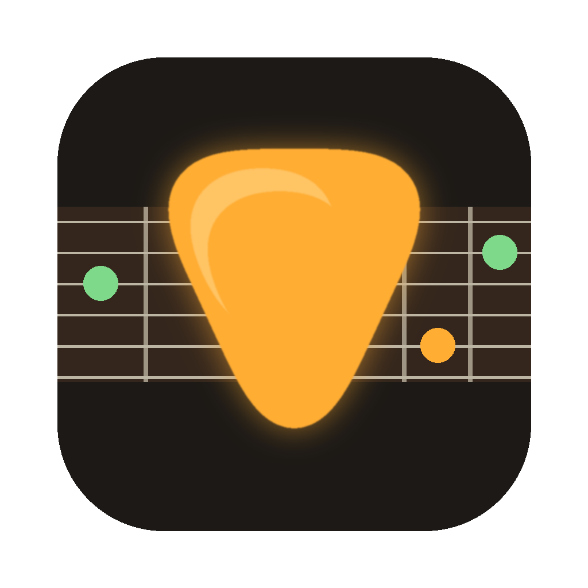
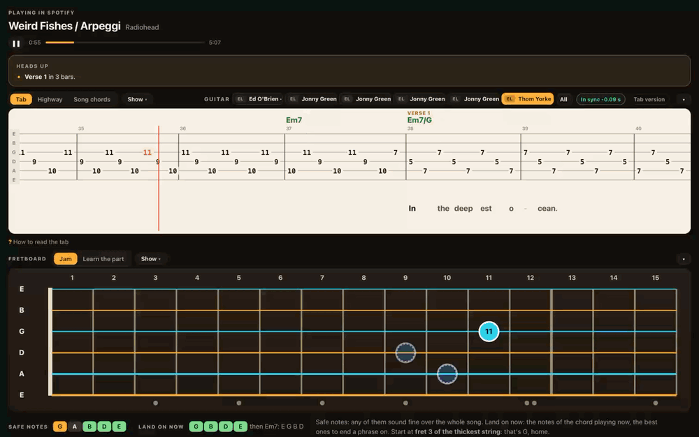
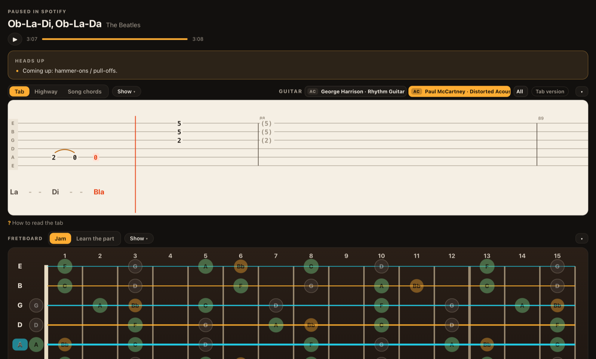

# MasterPrac

A macOS guitar practice app that follows whatever song is playing in Spotify and shows its guitar tab, a live fretboard and the lyrics, all in sync with the recording.

<p align="center"></p>



*Demo at 2x speed, no sound. [Full video (52 s)](screenshots/demo.mp4)*



## What it does

- **Follows the music.** Reads the song that is playing on the Mac and loads the matching Songsterr tab.
- **Stays in sync.** Listens to the recording and lines the tab up with it, keeping sync through pauses and tempo differences and cross-checking against the lyrics.
- **Shows how to play it.** A scrolling tab with techniques drawn as shapes (hammer-ons, slides, bends, vibrato), a fretboard that holds each chord shape, and chord diagrams for the whole song.
- **Word-timed lyrics.** Lyrics move with the tab, each word at the moment it is sung.
- **Practice mode.** Plays the song at 50%, 75% or 100% speed, loops a section, and offers backing tracks.
- **Jam mode.** Highlights chord tones and safe notes for improvising over the song.

## How it connects

- **The app itself:** a small web server that runs only on the Mac (`127.0.0.1:5070`), shown in a native macOS window. Nothing is open to the internet.
- **HeadRush Flex Prime (amp/pedal):** read over the home Wi-Fi network through the unit's built-in web API (`headrushflexprime.local`). MasterPrac shows the loaded rig, its effect blocks and knob settings, and only reads: it never changes anything on the amp.
- **Sound:** while practising, the Mac's audio can be sent to the HeadRush over Bluetooth, so the song plays through the amp.

## AI features (optional)

Two extras use Claude, through Claude Code if it is installed: the per-song amp tone guide and the "Ask" box on the Learn page. The core of the app (tab sync, fretboard, lyrics, practice and jam modes) runs without it.

## Built with

Python, Flask and pywebview for the app; JavaScript, HTML and CSS for the interface; Swift helpers for macOS audio and Now Playing; Songsterr and LRCLIB for tabs and lyrics. Developed with AI-assisted programming (Claude Code).

## Running it

macOS only.

```bash
python3 -m venv .venv && .venv/bin/pip install -r requirements.txt flask pywebview
./build_app.sh        # builds MasterPrac.app
```

## Author

Deniz Yildiz, Industrial and Systems Engineering, Binghamton University
